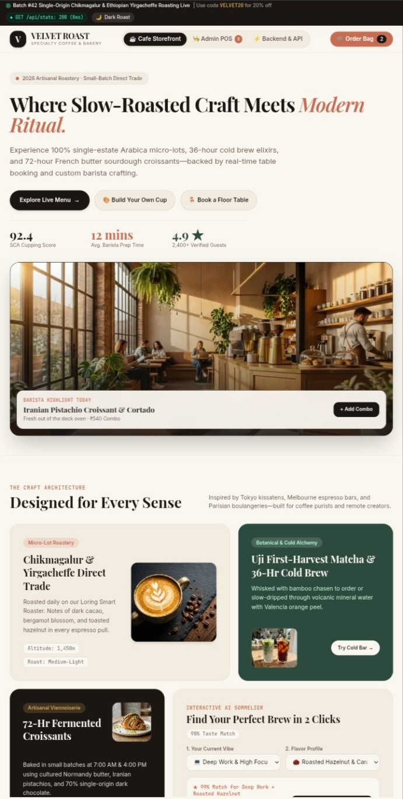
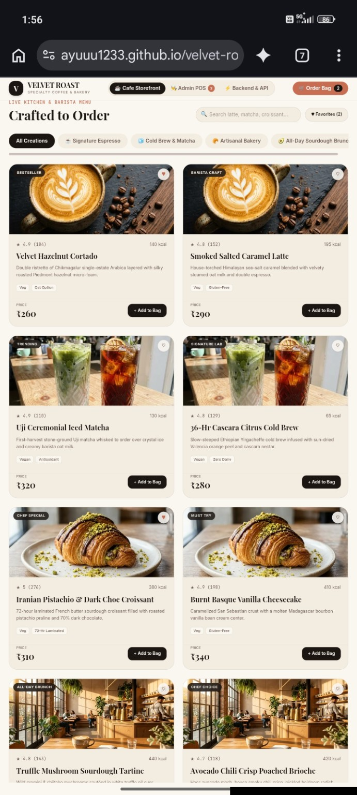

# ☕ Velvet Roast — Full-Stack Café Experience

<p align="center">
  
</p>

<p align="center">
  <strong>Where Every Sip Tells a Story.</strong>
</p>

<p align="center">
  A modern, elegant, and immersive café website designed to bring the warmth of a premium coffeehouse to the digital world.
</p>

<p align="center">
  
  
  
</p>

---

## ✨ About the Project

Velvet Roast is a full-stack café website built around the idea that great coffee deserves an equally great digital experience.

Inspired by the cozy atmosphere of specialty coffeehouses, the project combines sophisticated visual design, an inviting café identity, and functionality designed for modern customers.

From exploring the menu to discovering the café's atmosphere, Velvet Roast aims to create a seamless and memorable online experience.

## 🎯 Project Goals

- Create a premium and visually engaging café website.
- Deliver a responsive experience across desktop, tablet, and mobile devices.
- Showcase coffee, beverages, food, and café offerings.
- Build a foundation for full-stack functionality and future expansion.
- Maintain clean, organized, and maintainable code.

## 🚀 Features

- **Premium UI/UX** — Elegant layouts, refined typography, warm colors, and a coffee-inspired visual identity.
- **Responsive Design** — An adaptable interface for different screen sizes.
- **Digital Menu** — A dedicated space to explore coffee, beverages, snacks, and signature specialties.
- **Café Showcase** — Visual storytelling that communicates the brand's atmosphere.
- **Full-Stack Architecture** — A foundation for connecting frontend interfaces with backend services and data storage.
- **Interactive Experience** — Designed for smooth navigation and meaningful customer interactions.
- **Scalable Structure** — Built with room for future enhancements and additional features.

> Features such as online ordering, reservations, authentication, and an admin dashboard depend on their implementation in the application.

## 🛠️ Tech Stack

Velvet Roast is intended as a full-stack project. The following table is a template — update it to match the technologies actually used in your codebase.

| Layer | Technology |
| --- | --- |
| Frontend | Add your frontend framework or library |
| Styling | Add your CSS framework or styling approach |
| Backend | Add your server-side framework |
| Database | Add your database |
| APIs | Add your API architecture |
| Deployment | Add your hosting platform |

## 📂 Project Structure

A possible structure for the project:

```text
velvet-roast/
├── frontend/
│   ├── public/
│   ├── src/
│   └── package.json
├── backend/
│   ├── src/
│   ├── routes/
│   ├── controllers/
│   └── package.json
├── .env.example
├── .gitignore
└── README.md
```

The actual folder structure may differ depending on your implementation.

## ⚙️ Getting Started

Follow these steps to run the project locally.

### Prerequisites

Install the tools required by your chosen stack, such as:

- Git
- Node.js and npm, if your project uses Node.js
- Your project's required database
- A code editor

### 1. Clone the repository

```bash
git clone YOUR_REPOSITORY_URL
cd velvet-roast
```

Replace `YOUR_REPOSITORY_URL` with your actual GitHub repository URL.

### 2. Install dependencies

Navigate to the relevant frontend and backend directories and install their dependencies using the package manager specified by each project.

For an npm-based project:

```bash
npm install
```

Run this command separately in each application directory that has its own `package.json`.

### 3. Configure environment variables

Create the required `.env` file based on your project's configuration.

Example:

```env
PORT=5000
DATABASE_URL=your_database_connection
```

These variables are illustrative. Use the exact names and values required by your backend.

**Security note:** Never commit real passwords, API keys, database credentials, or other secrets to GitHub.

### 4. Start the application

Use the scripts defined in the respective `package.json` files.

For example, if the project defines a development script:

```bash
npm run dev
```

Start the frontend and backend separately if they run as independent services.

## 🎨 Design Philosophy

Velvet Roast follows a design direction inspired by specialty coffee culture:

- **Color palette:** Espresso brown, creamy beige, warm ivory, and muted gold.
- **Typography:** Clear, elegant, and easy to read.
- **Visuals:** Coffee photography, carefully composed imagery, and inviting layouts.
- **Experience:** Intuitive navigation, thoughtful spacing, and consistent design elements.

The goal is to make the website feel less like a generic template and more like a distinctive café brand.

## 📸 Screenshots

### Homepage



### Digital Menu



## 🗺️ Roadmap

Potential improvements for future versions:

- [ ] Complete responsive layouts across all pages.
- [ ] Connect the digital menu to backend data.
- [ ] Add product categories and search or filtering.
- [ ] Implement an online ordering workflow.
- [ ] Add table reservations, if required.
- [ ] Develop secure customer authentication.
- [ ] Create an admin dashboard for managing menu items and orders.
- [ ] Add automated tests and production deployment.

These items are planned enhancements, not claims that every feature is already available.

## 🔐 Security & Configuration

- Keep sensitive configuration in environment variables.
- Exclude `.env` files from version control.
- Validate and sanitize user input on the server.
- Protect administrative routes and customer data.
- Use secure authentication and authorization where applicable.

## 🤝 Contributing

Contributions and suggestions are welcome.

1. Fork the repository.
2. Create a feature branch.
3. Make your changes.
4. Test your implementation.
5. Submit a pull request with a clear description.

## 📄 License

A license has not yet been specified for this project. Add a `LICENSE` file before distributing the project under a particular open-source license.

## 👨‍💻 Author

**Ayush**

Building digital experiences with creativity, curiosity, and a passion for technology.

---

<p align="center">
  <strong>Velvet Roast</strong><br />
  <em>Crafted for coffee lovers. Designed for memorable experiences.</em>
</p>

<p align="center">
  Made with ☕ and creativity.
</p>
